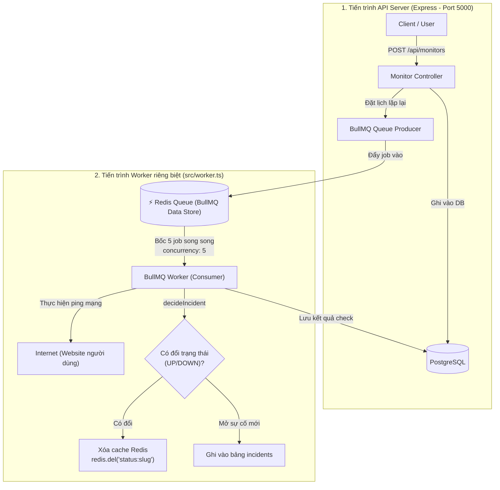

# ⚡ TUẦN 6: BULLMQ - HÀNG ĐỢI CÔNG VIỆC & BACKGROUND WORKER (~14 GIỜ)

> **Mục tiêu tối thượng của tuần:**
> 1. Hiểu bản chất mô hình **Producer - Queue - Consumer (Worker)**: Vì sao một hệ thống Backend chuyên nghiệp bắt buộc phải tách biệt tiến trình xử lý API và tiến trình chạy ngầm?
> 2. Biến **Redis** (đã học ở Tuần 5) thành **Message Queue / Job Queue** mạnh mẽ bằng thư viện **BullMQ**.
> 3. Tự động hóa hoàn toàn: Monitor tự động ping theo đúng chu kỳ (`interval_sec`) mà **không cần người dùng bấm nút "Check Now"**.
> 4. Quản lý vòng đời lịch trình công việc: Khi **Tạo / Sửa / Xóa monitor**, lịch ping trong Redis tự động cập nhật đồng bộ tương ứng.
> 5. Tách Worker thành một **tiến trình Node.js độc lập (`src/worker.ts`)**, cấu hình **Concurrency = 5**, đóng gói chạy trong Docker Compose.
> 6. Kết nối hoàn hảo toàn bộ thành quả từ Tuần 4 & Tuần 5: Sau mỗi lần Worker ping tự động $\rightarrow$ Gọi `decideIncident()` mở/đóng sự cố $\rightarrow$ Bắn hạ cache Redis nếu trạng thái thay đổi!

---

## 📋 DANH SÁCH CÔNG VIỆC CẦN LÀM (TASKS)

- [x] **Task 6.1:** Cài đặt `bullmq`, học khái niệm nền tảng (Producer, Queue, Worker, Job), chạy ví dụ "Hello World" gửi và nhận job đầu tiên qua Redis (2 giờ).
- [x] **Task 6.2:** Viết Worker nhận job `check`, gọi hàm `checkUrl` cho 1 monitor cụ thể và ghi kết quả vào bảng `checks` trong PostgreSQL (4 giờ).
- [x] **Task 6.3:** Thiết lập **Job Scheduler (Lịch chạy lặp lại)**: Mỗi monitor có 1 job chạy định kỳ theo `interval_sec`. Cập nhật lịch trình khi Tạo mới, Sửa interval hoặc Xóa monitor (4 giờ).
- [x] **Task 6.4:** Tách Worker thành một tiến trình hoàn toàn độc lập (`src/worker.ts`), cấu hình `concurrency: 5`, thêm service `worker` vào `docker-compose.yml` (2 giờ).
- [x] **Task 6.5:** Tích hợp bộ não phán quyết sự cố: Sau mỗi lần Worker check, tự động gọi `decideIncident` (Tuần 4) để mở/đóng sự cố trong Transaction và kích hoạt Xóa cache Redis (Tuần 5) nếu có biến động (2 giờ).

---

## 🧠 2 CÂU HỎI LÝ THUYẾT CỐT LÕI (CẦN TỰ TRẢ LỜI ĐƯỢC KHI PHỎNG VẤN)

### ❓ Câu hỏi 1: Vì sao KHÔNG ĐƯỢC gọi `checkUrl` trực tiếp trong API mà bắt buộc phải qua Hàng đợi (Queue)?
* **1. Nghẽn luồng xử lý (Blocking API Response):**
  * Hàm `checkUrl` phải gửi HTTP request ra Internet tới trang web của người dùng (có thể mất 500ms, thậm chí timeout 5 - 10 giây nếu web chết).
  * Nếu gọi trực tiếp trong API: Người dùng bấm "Tạo Monitor" sẽ phải ngồi nhìn màn hình quay tít mù chờ đợi 5 giây mới nhận được phản hồi.
* **2. Nguyên lý Tách rời (Decoupling) & Bất đồng bộ (Asynchronous):**
  * **API Process (Producer):** Chỉ làm đúng 1 việc: Kiểm tra dữ liệu hợp lệ $\rightarrow$ Ném công việc vào Redis Queue $\rightarrow$ Trả về ngay lập tức cho client `201 Created` trong **10ms**.
  * **Worker Process (Consumer):** Một tiến trình chạy ngầm riêng biệt, thong thả bốc công việc từ Redis ra để ping mạng và ghi DB. Nếu website của khách bị chậm hay sập thì chỉ có Worker đợi, API chính phục vụ người dùng vẫn chạy nhanh như gió!
* **3. Khả năng chịu lỗi (Fault Tolerance) & Thử lại (Retry):**
  * Nếu gọi thẳng trong API: Lỡ lúc đó mạng chập chờn $\rightarrow$ Toàn bộ request chết queo.
  * Khi qua Queue: Nếu Worker ping lỗi hoặc máy chủ sập đột ngột, job vẫn nằm an toàn trên Redis và tự động được phân phát lại cho Worker khác làm tiếp khi khởi động lại.

---

### ❓ Câu hỏi 2: `Concurrency = 5` nghĩa là gì? Nếu hệ thống có 1.000 monitor thì chuyện gì xảy ra?
* **`Concurrency = 5` là gì?**
  * Trong 1 Worker Process, tại một thời điểm nó cho phép nhận và xử lý song song tối đa **5 công việc (Jobs)** cùng lúc.
  * Vì việc kiểm tra website (`checkUrl`) chủ yếu là chờ đợi I/O mạng (Network I/O Wait) chứ không ngốn CPU, Node.js Event Loop có thể xử lý mượt mà hàng chục I/O cùng lúc mà không bị nghẽn.
* **Nếu có 1.000 monitor cùng đến hạn kiểm tra thì sao?**
  * **Không bao giờ bị sập hay tràn bộ nhớ!**
  * 1.000 công việc sẽ được xếp hàng ngay ngắn trong Redis Queue.
  * Worker bốc trước **5 job** ra ping đồng thời. Ngay khi có 1 job hoàn tất (sau ~200ms), Worker lập tức bốc tiếp job thứ 6 vào bù chỗ.
  * Cứ như vậy, toàn bộ 1.000 monitor sẽ được xử lý tuần tự, trơn tru theo đợt mà **không làm cạn kiệt cổng mạng (Socket exhaustion), không làm tràn RAM và không làm sập Database PostgreSQL**!
* **Khả năng Mở rộng (Horizontal Scaling):**
  * Nếu sau này hệ thống lên 100.000 monitor: Bạn chỉ cần bật thêm 5 - 10 container Worker chạy song song $\rightarrow$ Tất cả các Worker cùng cắm vào một Redis Queue để chia nhau làm việc!

---

## 🏗️ CẤU TRÚC KIẾN TRÚC TUẦN 6



---

## ⚠️ BẪY KỸ THUẬT QUAN TRỌNG VỚI BULLMQ (ĐỌC KỸ TRÁNH BUG)

1. **Lưu ý cấu hình Redis Connection cho BullMQ:**
   * BullMQ yêu cầu instance `ioredis` phải có cờ:
     ```ts
     maxRetriesPerRequest: null
     ```
   * *Lý do:* Worker sử dụng lệnh chặn (Blocking Command `BRPOPLPUSH`/`BLMOVE`) của Redis để chờ việc. Nếu `maxRetriesPerRequest` khác `null`, ioredis sẽ quăng lỗi crash ứng dụng ngay khi khởi động!
2. **Phiên bản BullMQ & Job Lặp lại (Repeatable Jobs / Job Schedulers):**
   * Trong BullMQ v5 mới nhất: Hỗ trợ cú pháp hiện đại `upsertJobScheduler`.
   * Cú pháp chuẩn:
     ```ts
     await queue.upsertJobScheduler(
       `monitor-${monitor.id}`,
       { every: monitor.interval_sec * 1000 },
       { name: 'check', data: { monitorId: monitor.id } }
     );
     ```
   * Khi xóa monitor: Phải nhớ xóa cả lịch trình này để tránh worker tiếp tục ping "bóng ma":
     ```ts
     await queue.removeJobScheduler(`monitor-${monitor.id}`);
     ```

---

## 🎯 TIÊU CHÍ NGHIỆM THU (DONE DEFINITION)

1. **Tự động hóa hoàn toàn:** Tạo 1 monitor mới trên hệ thống, không bấm nút gì cả, ngồi quan sát terminal thấy Worker tự động bốc job và bảng `checks` trong PostgreSQL tự động nhảy thêm dòng mới đúng theo chu kỳ `interval_sec`.
2. **Kích hoạt sự cố tự động:** Cho monitor ping vào 1 website lỗi (hoặc tắt website mẫu) $\rightarrow$ Sau đúng 3 lần lỗi liên tiếp, bảng `incidents` tự động mở 1 sự cố mới, `monitors.status` chuyển thành `down` và cache status bị xóa tức thì.
3. **Tiến trình độc lập:** Tắt API Server $\rightarrow$ Worker vẫn miệt mài chạy ngầm kiểm tra. Tắt Worker $\rightarrow$ Không có check mới nào sinh ra, bật lại Worker $\rightarrow$ Lập tức tiếp tục công việc không bị mất job.
